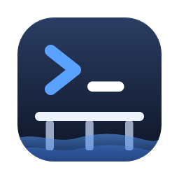

  

# Pier

제가 쓰려고 만든 맥용 터미널 프로그램이에요. SSH로 서버에 접속하는 터미널 옆에 파일 탐색기가 붙어 있어요. 맥에서 MobaXterm 같은 걸 쓰고 싶어서 만들었어요.

쓰고 싶은 분은 편하게 쓰세요. 버그 제보나 수정 요청도 언제든 환영이에요.

## 설치

설치 파일을 받아서 설치하면 돼요. 코드를 받거나 직접 빌드할 필요는 없어요.

1. [Releases 페이지](https://github.com/Banana-Master/pier/releases/latest)에서 가장 최신 `.dmg` 파일을 내려받아요.
2. 파일을 열고 Pier를 응용 프로그램 폴더로 끌어다 놓아요.
3. 처음 실행할 때 애플 개발자 서명을 하지 않은 앱이라서 "확인되지 않은 개발자"라는 경고가 뜰 수 있어요.
   - Pier를 우클릭하고 **열기**를 눌러 보세요.
   - 그래도 안 열리면 **시스템 설정 → 개인정보 보호 및 보안**에서 아래쪽의 **그래도 열기**를 눌러요. 한 번만 하면 돼요.

맥 전용이에요. 애플 실리콘(M1 이후) 맥에서 만들고 쓰고 있어요.

## 할 수 있는 것

### 접속

- 비밀번호나 키 파일로 접속해요. 키체인에 저장해 두면 클릭 한 번으로 접속돼요.
- 점프 호스트(ProxyJump)를 지원하고 연결이 끊기면 자동으로 다시 접속해요.
- tmux 자동 연결을 켜면 접속이 끊겨도 서버에서 작업이 계속 돌아가요. 다시 접속하면 하던 화면이 그대로 이어져요.
- 비밀번호 접속을 키 접속으로 바꿔 줘요. 키를 만들고 서버에 등록하고 로그인이 되는지 확인하는 것까지 앱이 해요.
- 서버를 폴더로 묶어 두고 `⌘K`로 바로 찾을 수 있어요. `~/.ssh/config`도 가져올 수 있어요.

### 터미널

- 탭, 좌우·상하 분할, 이 맥의 로컬 터미널을 한 창에서 써요.
- 자주 치는 명령은 스니펫(⚡)으로 저장해 두고 한 번에 실행해요.

### 파일 (왼쪽 패널)

- 파일을 끌어다 놓아서 업로드하고 다운로드, 이름 변경, 삭제, 새 폴더 만들기도 할 수 있어요.
- 터미널에서 `cd`를 하면 파일 패널도 같은 폴더로 따라가요.
- 이름 검색은 지금 폴더에서 바로 걸러 주고 하위 폴더 전체 검색도 돼요.
- 우클릭으로 권한 변경(chmod), 압축하기·압축 풀기, 다른 서버로 복사를 할 수 있어요.
- 파일은 내장 에디터나 VS Code 같은 외부 에디터로 열어요. 저장하면 서버에 바로 반영돼요. 그 사이에 서버에서 파일이 바뀌었으면 덮어쓰기 전에 물어봐요.

### 서버 상태 (아래쪽 상태바)

- CPU, 메모리, 디스크(물리 디스크 목록 포함), 네트워크, 온도를 보여 줘요. 마우스를 올리면 그래프가 나와요.
- 디스크가 꽉 차거나 CPU가 계속 높으면 맥 알림으로 알려 줘요.
- 프로세스 보기와 종료, 로그 실시간 보기, Docker 컨테이너 관리, SSH 터널(포트 포워딩)도 있어요.

## 비밀번호는 어디에 저장되나요

- 비밀번호는 파일에 저장하지 않아요. 저장을 선택하면 맥 키체인에만 들어가요.
- 처음 접속하는 서버는 기록해 두고 나중에 서버의 호스트 키가 바뀌면 연결을 막아요.
- 접속 목록(비밀번호 제외)은 `~/Library/Application Support/ssh-gui/connections.json`에 저장돼요.

## 알아두세요

- 상태바, 프로세스, 로그, Docker 같은 서버 관련 기능은 리눅스 서버를 기준으로 만들었어요. 맥이나 BSD 서버에서는 일부가 안 보일 수 있어요.
- 알림은 "Script Editor"라는 이름으로 와요. 안 보이면 시스템 설정의 알림에서 허용해 주세요.

## 버그 제보와 수정 요청

쓰다가 이상한 점이 있거나 있었으면 하는 기능이 있으면 [Issues](https://github.com/Banana-Master/pier/issues/new)에 남겨 주세요. GitHub 계정이 필요하고 글이 모두에게 공개되니까 서버 주소나 비밀번호는 적지 말아 주세요.

---

직접 빌드하거나 코드를 보고 싶다면 [DEVELOPMENT.md](DEVELOPMENT.md)를 참고하세요.
